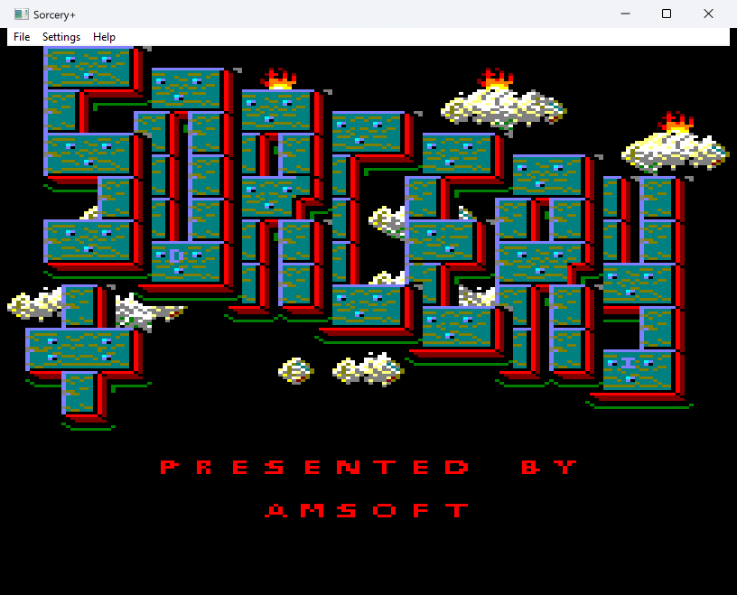
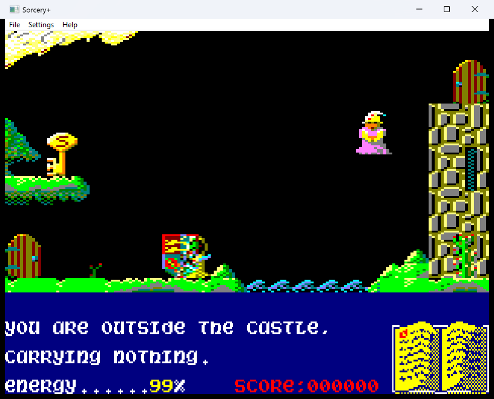
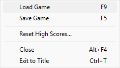
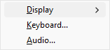
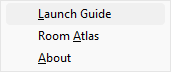
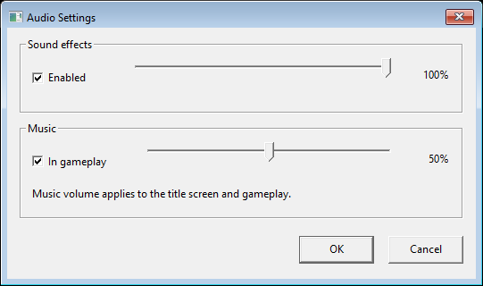
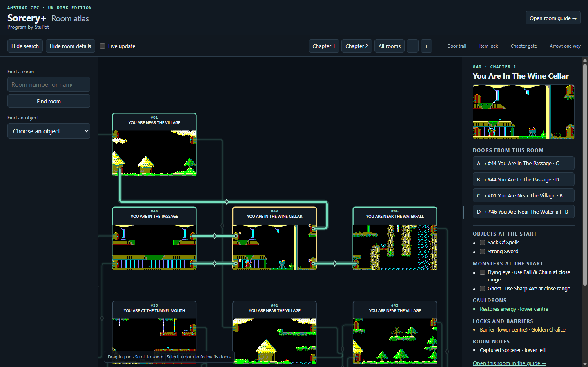
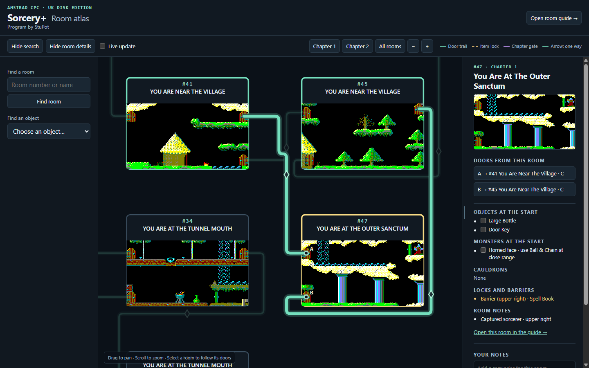
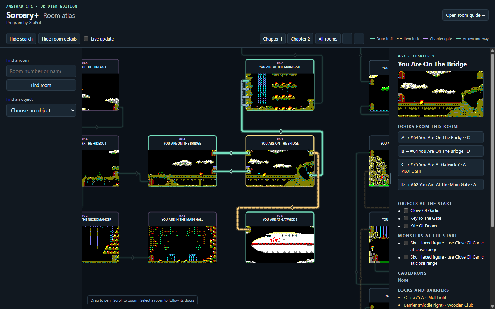

# Sorcery+ for Windows

**Native Amstrad CPC recompilation · Windows 11 x64 · v2.7 · Program by StuPot**

Sorcery+ is a two-chapter adventure where you fly between rooms, rescue captured sorcerers, and find the right objects to defeat monsters and open doors. This project translates the game's original Z80 machine code into C at build time. The Windows program handles display, audio, input, saves, and the interactive room atlas.

[Compatible disk](#compatible-disk) · [Build and play](#build-and-play) · [Controls](#controls) · [Windows menus](#windows-menus) · [Room atlas](#room-atlas) · [Source layout](#source-layout)

### Gameplay screenshots

| Title screen | Outside the Castle |
| --- | --- |
|  |  |

## Compatible disk

Supply your own Amstrad CPC `.dsk` image. The build uses the following UK disk dump. The filename is listed for identification and can be changed. Compatibility is checked using SHA-256.

| Field | Tested disk image |
| --- | --- |
| Filename | `Sorcery Plus (UK) (1985).dsk` |
| MD5 | `463492394b61a118543fd49f8f669ca9` |
| SHA-256 | `f5dee21140345ea84bee66ccf86db892c079ce13bc1d13c240a2103ba0ce2a26` |

To check a disk without installing the build tools, open PowerShell in this folder and run:

```powershell
powershell.exe -NoProfile -ExecutionPolicy Bypass -File .\Build.ps1 -CheckDisk -Disk 'C:\Games\Sorcery Plus (UK) (1985).dsk'
```

Replace the example path with your own. You can also put a copy beside `Build.ps1` named `game.dsk` and omit `-Disk`. If you get **Unsupported disk image**, check the hash against the table. Renaming a different dump does not change its hash.

## Build and play

1. Install **Python 3.10 or newer**, **Node.js 22.2 or newer**, and **Zig 0.15.2**. Put their executables on `PATH`, then open a new PowerShell window in the project folder. [Python downloads](https://www.python.org/downloads/windows/) · [Node.js downloads](https://nodejs.org/en/download) · [Zig downloads](https://ziglang.org/download/)
2. Run the command below, replacing the disk path with yours. If you put `game.dsk` beside `Build.ps1`, you can leave out `-Disk` and its path.

   ```powershell
   powershell.exe -NoProfile -ExecutionPolicy Bypass -File .\Build.ps1 -Disk 'C:\Games\Sorcery Plus (UK) (1985).dsk' -Launch
   ```

3. Wait for the title screen and press **Z**. The EXE is written to `native\build\SorceryPlus.exe`. It contains the game data and atlas generated from your disk, so you can run your local build from a writable folder on a compatible PC. The build reads your disk image without changing it.

In Visual Studio Code, open [`SorceryPlus.code-workspace`](SorceryPlus.code-workspace). With `game.dsk` in the project folder, use **Ctrl+Shift+B** to build or **Terminal → Run Task → Build and run Sorcery+** to build and launch. To use a disk elsewhere, run the PowerShell command above from the VS Code terminal.

If a tool is outside `PATH`, pass its full path with `-Python`, `-Node`, or `-Zig`. The [build notes](native/BUILD.md) describe the build stages and diagnostics.

The source-only build was tested on Windows 11 x64 with the disk listed above. A fresh copy of the EXE reached Outside the Castle in a 400-frame gameplay run and matched the original v2.7 build's graphics and audio checksums. The build verifies all 75 room images and 97 map connections.

## Controls

| Action | Default key |
| --- | --- |
| Fly and move | Arrow keys |
| Start or fire / use object | Z |
| Pause or resume | Space |
| Save / load | F5 / F9 |
| Toggle fullscreen / return to windowed mode | F11 or Alt+Enter / Esc |
| Return to the title / close | Ctrl+T / Alt+F4 |

XInput controllers can use the D-pad or left stick, **A** for fire, and **Start** for pause.

## Windows menus

| File | Settings | Help |
| --- | --- | --- |
|  |  |  |

| Menu option | What it does |
| --- | --- |
| **File → Load Game / Save Game** | Choose a saved game or save your current progress under a filename of your choice. |
| **File → Reset High Scores** | Restore the original high-score table for the current profile after confirmation. |
| **File → Close / Exit to Title** | **Close** quits the program and offers to save a game in progress. **Exit to Title** ends the current game and keeps the program open. |
| **Settings → Display** | Toggle borderless fullscreen, choose sharp pixels or smooth scaling, and switch between classic 4:3 and wide 8:5 framing. |
| **Settings → Keyboard** | Change the keys for movement, fire, and pause. |
| **Settings → Audio** | Set sound effects and gameplay music independently. The music volume applies to both gameplay and the title theme. The music switch applies during gameplay only. |
| **Help → Launch Guide / Room Atlas / About** | Read the built-in guide, open the atlas in your browser, or see the version and program credit. |



Preferences, saves, high scores, and atlas notes are stored under `profiles` beside the EXE by default. See the [launch guide](native/LAUNCH.txt) for details.

## Room atlas

Choose **Help → Room Atlas** to explore all 75 rooms in your browser. Keep the game open while using the atlas.

| Atlas option | What it does |
| --- | --- |
| **Chapter 1 / Chapter 2 / All rooms** | Fit one chapter or the full map. Drag to pan, and scroll or use **− / +** to zoom. |
| **Find a room** | Jump to a room by number or name. Clicking a room on the map highlights its door connections. Click a door in the details panel to follow it. Dashed gold trails mark item locks, purple marks the chapter gate, and arrows show one-way links. |
| **Find an object** | List locations by the number of door transitions from the selected room. Click a result to select that room on the map. |
| **Room details** | Inspect doors, objects, monsters, cauldron effects, lock and barrier requirements, and room notes. Check an object or monster to show it in the room preview. Drag the divider to resize the panel. Use the toolbar to show or hide either sidebar. |
| **Live update** | Show current objects, monsters, and rescued sorcerers. A gold frame marks the player's room and its preview shows the player's position. Turn live update off to see the starting room setup. |
| **Save note / Open room guide** | Save your own notes for a room in `profiles\Room-Notes.json`, or open the separate guide for a room-by-room reference. |

### Atlas screenshots

**Wine Cellar · Room 40 · Chapter 1**  
The room details show its restorative cauldron, the Golden Chalice barrier, and the four highlighted door connections.



**Outer Sanctum · Room 47 · Chapter 1**  
The preview shows the captured sorcerer. The details list the Spell Book barrier and the two routes back toward the village.



**The Bridge · Room 63 · Chapter 2**  
The gold dashed trail shows the locked route to Gatwick. The door list names the required item.



## Source layout

| Path | Contents |
| --- | --- |
| [`Build.ps1`](Build.ps1) | Checks the disk, extracts game data, translates Z80 code, generates the atlas, and builds the Windows EXE |
| [`native/`](native) | Translator, Windows host, and [technical notes](native/native-analysis.md) |
| [`map/`](map) | Atlas extraction, room capture, layout, and HTML templates |
| [`tools/`](tools) | CPC disk extraction script |

## Credits and project notice

The supplied CPC edition credits Virgin Games, 1985. The Windows recompilation and room atlas are by **StuPot**.

This independent project documents the recompilation for educational and preservation purposes. The original game code, graphics, music, and artwork belong to their respective rights holders. This source edition contains the build tools and documentation. The game data is generated locally from the disk image you provide.

The software is provided “as is,” without warranty. To the extent permitted by applicable law, the project maintainer disclaims liability for loss or damage arising from its use.
